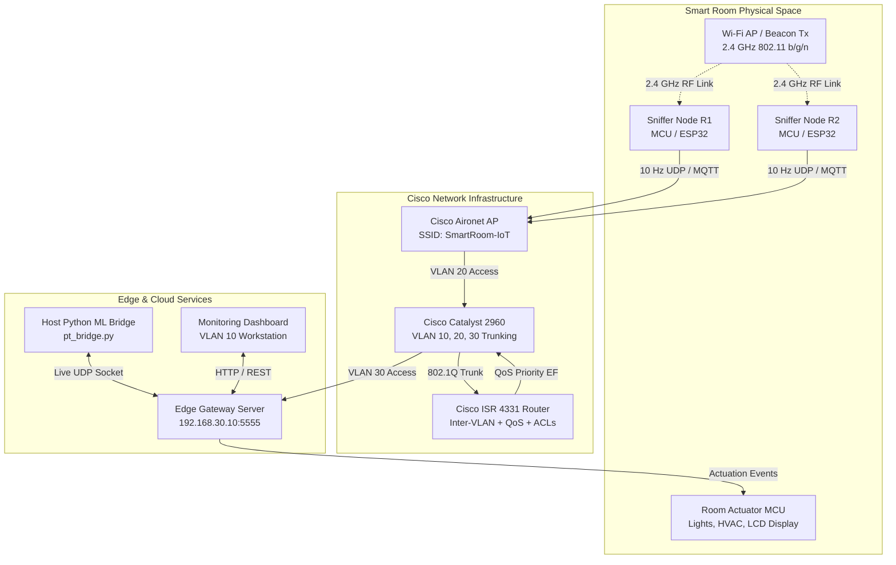

# Cisco Packet Tracer Smart Room Digital Twin & IoT Testbed

This package provides a **Cisco Packet Tracer** integration and network infrastructure model for the **Wi-Fi Signal Strength–Based Smart Room Occupancy Detector**.

While **NS-2** focuses on low-level 802.11 MAC collisions and channel propagation models, **Cisco Packet Tracer** simulates the complete enterprise network deployment, IoT telemetry pipelines, and smart building automation actuators.

---

## 🏛️ Architecture Overview



---

## 🌐 Network Segmentation & VLANs

| VLAN ID | Subnet | Role | Devices | QoS / Security Policy |
| :--- | :--- | :--- | :--- | :--- |
| **VLAN 10** | `192.168.10.0/24` | Operator Workstations | Monitoring PC, Dashboard | Standard Fair-Queue |
| **VLAN 20** | `192.168.20.0/24` | IoT Sensor Network | Sniffers R1/R2, Room Actuators | DSCP EF (Expedited Forwarding), Strict ACL Isolation |
| **VLAN 30** | `192.168.30.0/24` | Edge Processing & Brokers | Edge Inference Server, MQTT Broker | High Priority, Inbound from VLAN 20 |
| **VLAN 99** | `192.168.99.0/24` | Management (Native) | Switch SVI, Router Management | Out-of-band admin access |

---

## 📁 Package Contents

```text
cisco_packet_tracer/
├── README.md                           # Comprehensive documentation & setup guide
├── network_configs/
│   ├── switch_c2960.ios                # Cisco Catalyst 2960 IOS config (VLANs, Trunk, PortFast)
│   └── router_c4331.ios                # Cisco ISR 4331 IOS config (Inter-VLAN, DHCP, QoS, ACLs)
├── iot_scripts/
│   ├── sniffer_node.py                 # Packet Tracer MCU script: 10 Hz RSSI streaming
│   ├── edge_gateway_server.py          # Packet Tracer Server script: Ingestion & decisions
│   └── room_actuators.py               # Packet Tracer MCU script: GPIO Lights, HVAC & LED
└── bridge/
    └── pt_bridge.py                    # Host Python to Packet Tracer telemetry bridge
```

---

## 🚀 Setting Up the Topology in Cisco Packet Tracer 9.0

### Step 1: Place Network Hardware
1. **Router**: 1× Cisco ISR 4331 (`RTR-GATEWAY-ROOM01`).
2. **Switch**: 1× Cisco Catalyst 2960 24-Port (`SW-CORE-ROOM01`).
3. **Wireless**: 1× Cisco Aironet Access Point (`AP-SMART-ROOM-WIFI`).
4. **Edge Computing**: 1× Server-PT (`EDGE-INFERENCE-SERVER`).
5. **IoT Devices**: 
   - 2× MCU or SBC for Sniffers (`R1`, `R2`).
   - 1× MCU for Actuator Controller (`ROOM-ACTUATORS`).
   - 1× Smart Light, 1× Ceiling Fan, 1× LED Status Indicator.

### Step 2: Apply Cisco IOS Configurations
1. Open the CLI tab of `SW-CORE-ROOM01`, paste the commands from `network_configs/switch_c2960.ios`.
2. Open the CLI tab of `RTR-GATEWAY-ROOM01`, paste the commands from `network_configs/router_c4331.ios`.

### Step 3: Configure IoT Python Scripts
Inside Cisco Packet Tracer:
- Open `R1` -> Programming Tab -> New Python Project -> Paste `iot_scripts/sniffer_node.py` (Set `NODE_ID = "R1"`).
- Open `R2` -> Programming Tab -> New Python Project -> Paste `iot_scripts/sniffer_node.py` (Set `NODE_ID = "R2"`).
- Open `EDGE-INFERENCE-SERVER` -> Programming Tab -> Paste `iot_scripts/edge_gateway_server.py`.
- Open `ROOM-ACTUATORS` -> Programming Tab -> Paste `iot_scripts/room_actuators.py`.

---

## 🔌 Running the Live Host Bridge

To connect the real host machine's Python ML models or mock data collectors to the running Cisco Packet Tracer simulation:

```bash
# Run a demo scenario cycle through the Packet Tracer bridge
python3 cisco_packet_tracer/bridge/pt_bridge.py --host 127.0.0.1 --demo
```

### Programmatic Usage in Python

```python
from cisco_packet_tracer.bridge.pt_bridge import PacketTracerBridge

bridge = PacketTracerBridge(pt_host="192.168.30.10", edge_port=5555, actuator_port=5556)

# 1. Stream 10 Hz RSSI packet from real ESP32 / synthetic engine
bridge.send_rssi_sample(node_id="R1", seq=101, rssi=-54.2)

# 2. Transmit occupancy decision from the Random Forest model
bridge.send_occupancy_state(state="OCCUPIED_STATIC", confidence=0.94, is_occupied=True)
```
